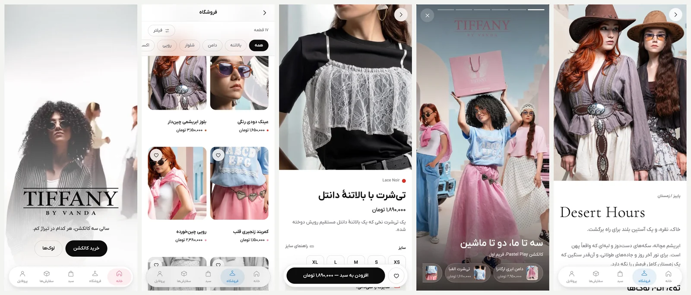

# TIFFANY by Vanda — shop preview

A black-and-white, installable storefront for **TIFFANY by Vanda**, women's
ready-to-wear, Iran. **Persian throughout, right to left**, iOS design language,
built as a PWA so it installs from Safari with no app store in the way.

Live: **https://ilyatabrizi.github.io/tiffany/**
Instagram: [@tiffanyiran](https://instagram.com/tiffanyiran)



---

## Language

The interface is Persian and the page is `dir="rtl"`. What deliberately stays in
Latin script is everything that is a **name** rather than a word:

- the wordmark, **TIFFANY / BY VANDA**
- the three collection names, **Pastel Play**, **Lace Noir**, **Desert Hours**
- the size codes, **XS–XL** (one-size reads فری‌سایز)
- the Instagram handle and **Alpha Agency**
- the order number prefix, `TF-`

Translating those would be translating a logo.

Type is **IRANYekanX**, the Farsi-numeral cut, as a single variable file —
every weight from one 90KB download. The FaNum build maps a Latin digit to ۰–۹
itself, which is why nothing in the JavaScript ever converts a digit; prices and
dates come from `Intl` with `fa-IR`, so the thousands separator is ٬ and dates
are Jalali. Cormorant is still here but is held to a Latin `unicode-range`, so
the collection names keep their serif and no Persian word is ever asked of a
font with no Persian in it.

Two rules that cost real bugs on the way:

- **Arabic script is never letter-spaced** — it breaks the joins. Tracking comes
  back only on runs that are Latin by construction.
- **`·` and `۰` are the same circle in this face.** The middot is banned
  outright as a separator, and the suite fails the build if one appears.

## Three languages (since 5 Oct 2026)

Persian is the default, and **every fresh visit opens in Persian**. A small
glass pill in the hero's top corner switches to **English** or **Türkçe** for
the rest of that visit (`sessionStorage`, key `tiffany.lang`); the switch
reloads the page so every formatter and string is read once, in one language.

- Strings live where they are shown as `L('فارسی', 'English', 'Türkçe')` —
  `js/i18n.js` holds the switch, the catalogue in `js/data.js` is trilingual.
- The **tab bar is English in all three** (the studio's call), and so is
  Alpha's signature — "Powered by Alpha Agency", never Persian.
- English and Turkish run left to right in **Inter** with Latin digits
  (`1,680,000 Toman` / `1.680.000 Toman`); Persian keeps IRANYekanX and ۰–۹.
  Turkish ğ ş İ come from Latin-Extended halves of Inter and Cormorant that
  only download when those letters are on the page.
- The bag stores a colour's **hex** and one-size as **`OS`**, never a
  translated label, so a bag filled in one language reads right in another.
- Persian copy is written colloquially (خودمونی), not in book Persian.
- Removed at the studio's request: the piece count in the shop, the footer
  tagline / free-delivery line / preview notice, the colour quote, the empty-bag
  line about small runs, and the Profile → Colour switch (the rule is fixed at
  "on touch"). «لوک‌ها» is now «استوری‌ها».

## The idea

Two rules hold the whole design together.

1. **The interface is ink on paper.** No colour in the chrome — no coloured
   buttons, no coloured headings, no brand tint on a card.
2. **Colour belongs to the clothes.** Every photograph is greyscale at rest and
   comes to life when you reach for it.

On a laptop that means hover. A phone has no hover, so colour arrives a
different way: **whatever photograph is in the middle third of the screen is in
colour, and it drains as it leaves.** Scrolling the shop paints it. The one
exception is the campaign film and the look viewer, which are always in colour —
those are the brand talking, not the catalogue.

A visitor who disagrees can change it in Profile → Colour: *On touch*,
*Always*, or *Never*.

The five tabs each own one of five accents, and that accent is the only colour
in the chrome — it shows on the tab you are standing on, on a pressed button,
and on a hovered link. Home is blush, Shop sky, Bag cherry, Orders rust,
Profile lilac.

## What is in it

| Tab | What it does |
| --- | --- |
| **خانه** | Full-bleed campaign film, the three collections, new in, the looks strip, an editorial block |
| **فروشگاه** | 17 pieces, category chips in a sticky glass bar, a filter sheet for collection / size / sort |
| **سبد** | Line items with steppers, a free-delivery bar, a full checkout sheet that writes a real order |
| **سفارش‌ها** | Order list with a live status, a five-stage tracking sheet, and a sample so an empty tab still demos |
| **پروفایل** | Saved pieces, orders, **اندازه‌های من**, delivery details, colour mode, light/dark, install |

Beyond the five:

- **The look viewer** — swipe six full-bleed campaign frames; every look carries
  the pieces it was shot in as glass chips that go straight to the product.
- **Your fit** — save bust / waist / hip once and every product page names the
  size the studio would hand you, adjusted for how that piece is cut.
- **Light and dark** — a black-and-white brand should invert cleanly, so it does.
  Auto follows the phone.
- **Installable and offline** — service worker, maskable icons, three shortcuts.

## Running it

```bash
python3 serve.py          # http://localhost:8131
```

```bash
python3 e2e.py            # 121 checks in a real browser, plus docs/shots/
```

`e2e.py` drives the system Chrome through Playwright — no browser download. It
walks every route, adds to the bag, checks out, tracks the order, opens the look
viewer, flips both appearance switches, and fails on **any** console error,
page error or failed request.

It also guards the Persian specifically: that the page is `fa`/`rtl`, that
IRANYekanX is the resolved body face, that no Latin digit and no middot reach
the page, that the thousands separator is ٬, that no Latin comma or question
mark is sitting inside a Persian sentence, and that paging the look viewer's
**RTL** scroll track still lands on the right slide — engines disagree about the
sign of `scrollLeft` in RTL, so the viewer probes it rather than assuming.

## Rebuilding the assets

```bash
python3 scripts/build_assets.py            # everything
python3 scripts/build_assets.py hero       # or one stage
```

Needs Pillow and imageio-ffmpeg. Stages: `photos`, `brand`, `icons`, `sig`,
`og`, `hero`, `sheet`. The last one writes `docs/contact-sheet.png` — a grid of every
crop, so framing gets checked rather than hoped.

What the studio sent, and what it became:

- **Six campaign frames** → 28 WebP crops at 480/960 (cards, collections,
  editorial) and 720/1080 (the full-bleed looks).
- **The wordmark** (transparent PNG) → white and ink versions, the app icons at
  180/192/512/1024, a maskable, a favicon, and the CSS mask used for the boot
  animation and the hero.
- **Alpha's own lockup** → split into two alpha masks, because it ships as white
  letterforms plus two yellow bars and would be invisible on paper. The letters
  take `--ink` and invert with the theme; the bars keep Alpha's yellow, the one
  colour on this site that is not TIFFANY's to spend.
- **A 22-second studio film** → a silent, 576-wide, 1.4MB H.264 loop trimmed to
  the clean middle (the master opens and closes on black flash frames) and faded
  through white at both ends, so the loop seam reads as a breath rather than a
  cut. Plus a WebP poster for Low Power Mode and reduced-motion.

The uncompressed 3.8MB master stays local — it is in `.gitignore`, not on the web.

## Structure

```
index.html            shell: boot veil, two glass bars, viewer, sheet root
css/app.css           one stylesheet, tokens first, light + dark
js/
  app.js              boot, routing, tabs, top bar, one click delegate
  router.js           hash router with a scroll memory
  store.js            one localStorage blob — bag, wishlist, orders, fit
  data.js             the catalogue (see the warning below)
  ui.js               cards, sheets, toasts, the size engine
  colour.js           the middle-of-screen colour observer
  hero.js             the campaign film, paused when out of view or hidden
  looks.js            the full-screen look viewer
  views/              home, shop, collection, product, bag, orders, saved, profile
scripts/build_assets.py
e2e.py
```

## ⚠️ Everything commercial is placeholder

The **photography is the studio's own**. Nothing else is.

Every product name, price, fabric, care instruction, measurement, delivery
time, returns window and the free-delivery threshold is copy written to make
the preview read like a real shop — **in Persian, which makes it read more
convincingly, not less**. The three collections — Pastel Play, Lace
Noir, Desert Hours — are named from the campaigns, not from the studio's own
line sheet. Product photographs are **crops of campaign frames**, not shot on
white; a real shop needs real product photography.

Replace `js/data.js` and `js/config.js` before this goes anywhere near a
customer.

Nothing here talks to a server. Checkout writes to `localStorage` and no card
is charged. Everything a visitor types stays on their phone.

## Deploying

The repo is the site — GitHub Pages serves `main` at root, `.nojekyll` is
there, `404.html` bounces deep links back through the hash router.

```bash
git add -A && git commit -m "…" && git push
```

Built by Alpha Agency.


## Back office (پنل مدیریت) — added 2026-10-09

The shop now runs on a small PHP + SQLite backend on the same cPanel host.

| Path | What it is |
|---|---|
| `/admin/` | The panel: dashboard + income stats, orders, products (with photo upload), customers, site visits, settings and team. Persian, phone first. |
| `/api/catalog.php` | The live catalogue the shop loads at boot (ETag, never cached by the service worker). |
| `/api/order.php` | Places a real order — only while the CEO has switched online ordering on. Prices come from the database, never the browser. |
| `/api/track.php` | Order status for the customer's Orders tab (code + phone). |
| `/api/hit.php` | Page-view counter: no IPs stored (daily-salted hash). Adds the device line only for browsers carrying `tf_c=1`. |
| `/api/consent.php` | The cookie sheet's answer: sets `tf_c` (1 = yes, a year; 0 = no, six months) and tallies yes/no. |
| `/api/admin.php` | Everything the panel does (session + CSRF, rate-limited logins). |
| `~/tiffany-data/` | Outside the web root: `tiffany.sqlite`, `SETUP-KEY.txt`, admin sessions, `error.log`. |

**First sign-in:** open `/admin/`, enter the setup key from `tiffany-data/SETUP-KEY.txt`
(cPanel → File Manager), and create the CEO account. The key rotates after every use
and also resets a forgotten CEO password. Roles: `ceo` (everything) and `admin`
(products, orders, customers — no money totals, settings or team).

The database's first catalogue is `api/lib/seed.json` (the 17 preview pieces).
Uploaded photos are re-encoded to 4:5 WebP at 480/960 in `uploads/p/`.

**Tests:** `api_test.py` (138 API checks), `admin_e2e.py` (38 browser checks, panel ↔ shop),
`popups_e2e.py` (56 checks: the two opening sheets on iPhone, Android, Samsung, Instagram,
desktop, English, installed), `e2e.py` (storefront), `qa_e2e.py` (33 regression checks
from the 2026-10-16 review) — all run against `php -S` with `TIFFANY_DATA` pointing at a
fresh folder (the storefront suites also need `catalog-import.json` in it).
`load_test.py` is the rush and traffic test, for a LOCAL server only (see below).

## The two opening sheets — added 2026-10-09

Once the opening animation lifts, the shop asks two things, one after the other:

1. **Cookies and device info** (`js/consent.js`), on every device, until answered.
   *Accept* → each page view carries a short line of words worked out in the browser
   (`js/device.js`): phone/tablet/computer, maker (Apple, Samsung, Xiaomi…), system,
   browser (including Instagram/Telegram in-app), installed app or browser, site language.
   The server keeps only words from its own list (`TF_DEV` in `api/lib/boot.php`), as
   daily tallies — never per person, no model numbers, no screen sizes, no location.
   *Essentials only* → nothing changes; visits are counted as before.
   Profile → «کوکی‌ها و حریم خصوصی» changes the answer; the terms page explains it.
2. **Add to home screen** (`js/install.js`), phones only, never once installed.
   Chrome/Samsung/Edge on Android get the real install button when the browser offers
   one; iPhone gets Safari's three steps with its own glyphs; Instagram/Facebook/Telegram's
   in-app browsers get "open it in Safari/Chrome first" plus a copy-link button.
   Snoozes four days after each showing, stops after three, or at «دیگه نشون نده».

The panel's «بازدید سایت» page shows the tallies: acceptance rate, coverage, installed-app
share, then ranked bars for device type, brand, system, browser, app/web and language.

## Real catalogue: Autumn / Winter 2027 — added 2026-10-14

The 17 preview pieces, the three made-up collections and their stories are gone.
The shop now carries the studio's first real collection: 28 pieces cut from seven
look photos, one collection (`aw27`) and the seven looks as stories.

- `catalog/aw27/catalog.py` builds everything from the screenshots in `catalog/aw27/src/`:
  a 4:5 crop per piece (`assets/img/aw-<id>-480/960.webp`), the 9:16 stories, the
  collection cover and the home editorial, plus `catalog-import.json`.
- **One-time import:** drop a `catalog-import.json` into `tiffany-data/` (outside the
  web root). On the next request `api/lib/boot.php` validates every piece and, only if
  all pass, replaces the whole catalogue. The file's hash is remembered, so it never
  imports twice; a bad piece changes nothing and is named in `error.log`.
- Sizes now include trouser waists (34–42) and shoe sizes (37–40) next to XS–XL and
  one size. The size guide and the fit box only show for letter-sized pieces, and the
  size pick snaps to sizes the piece is actually made in.
- Every price is a placeholder (1,000,000 Toman) until the studio sets real prices in
  the panel.

## The real catalogue, from the «Tiffany products» group — 2026-10-19

The 28 placeholder pieces (one price, cut from seven low-resolution screenshots)
are replaced by the studio's own list: 82 pieces, real prices, 22 outfits as
stories, and the p2-5 film in the hero.

- **Source:** `catalog/real/group.txt` is the exact copy of the group's 88 messages
  (24 captioned posts, C1–C24). Names, fabrics, colour lists, sizes and prices come
  from it word for word; photos are the studio's full-resolution `DSC*.JPG` files
  (kept on the Mac, not in git).
- `catalog/real/catalog.py SRC OUT` cuts the 4:5 piece crops
  (`assets/img/r-<id>[-k]-480/960.webp`), the 22 story frames (`r-look-N`), the
  collection cover (`r-col`) and the editorial (`r-ed`), and writes
  `catalog-import.json` plus `looks.json` (pasted into `LOOKS` in `js/data.js`).
- `catalog/real/check.py` maps every caption item to its piece and fails on any
  price that differs from the caption text. The one exception is recorded in it:
  C19 writes the shirt as ۹۹۰۰۰۰; Ilya confirmed ۷٬۹۹۰٬۰۰۰ like the other four posts.
- Pieces repeated word for word in several posts are listed once (the five-colour
  shirt, caps, sneakers, the C4/C5 set). Merged on matching photos and details:
  the oversize coat (C17 + C19), the green/cream jeans (C10 + C24), the fleece
  trousers (C4/C5 + C12) and two bandanas worn twice.
- Ilya's answers for what the captions leave open: C12 leather jacket S/M/L; the
  C5 teddy coat in five colours (سفید، کرم، زرشکی، مشکی، شکلاتی); C23 jeans size 41 → 42.
- **Hero:** `media/hero-2.mp4` is p2-5 at 720×1280, silent, H.264, 2.2MB, cut at
  20.8 s so the black logo card at the end does not flash behind the wordmark on
  every loop. Poster `media/hero-2-poster.webp`. The studio's file stays local
  (`catalog/real/src/`, in `.gitignore`).

## Full review: bugs, security, rush and traffic — 2026-10-16

Two independent code reviews (backend security, front end), then every fix covered
by a check that fails on the old code (`qa_e2e.py`, and the «hardening» part of
`api_test.py`).

**What changed for customers**
- Checkout never makes up an order any more. With online ordering switched off it
  says «خرید آنلاین به‌زودی» and points to Instagram and the stores; the bag stays.
  Orders kept on a phone from the old preview checkout say «پیش‌نمایش؛ ارسال نشد».
- If the catalogue could not be fetched (a shaky connection), checkout still sends the
  order and the server decides; it used to fall back to a fake local order.
- One order at a time: closing the sheet mid-send and checking out again cannot order twice.
- Bags and saved lists from the old catalogue are cleaned once a fresh catalogue is in
  (gone pieces dropped, old size/colour labels rewritten to codes, doubles merged).
- Limits, the same in the bag and on the server: 5 of one piece/size/colour, 20 pieces
  per order, at most 3 unconfirmed orders per phone number.
- Measurements typed with Persian digits work; the back arrow returns to the same spot
  in the grid and never leaves the site; sheets keep keyboard focus inside; the stories
  close on back; an order shows the price paid, not today's price.
- `404.html` sends people to `/` (it used to loop at nested addresses); the service
  worker leaves `/admin` and `/api` alone with or without the trailing slash.

**Server**
- Rate limits count IPv6 per /64; orders: 60 tries and 15 placed per address an hour
  (Iranian carriers put many phones behind one address); logins: 20 per address,
  6 per address+email, 30 per email, so locking someone out now takes many addresses
  instead of six guesses (the CEO can always get back in with the setup key).
- No session file for anonymous requests; expired sessions are swept.
- New accounts start with a random session version (a deleted user's cookie can no
  longer wake up as the next account); unknown emails cost the same time as wrong
  passwords.
- The product editor sends the stock it opened with; the server applies only the change,
  so orders placed meanwhile keep their pieces. Order status moves are conditional, so
  two people cancelling at once restock once.
- The visit counter only stores the shop's own pages and caps one address at 1500/hour.
- The data folder is refused if it is ever inside the web root.

**Rush and traffic (`load_test.py`, local, 16 PHP workers on 2 CPUs)**
- 300 people at once for the last 10 of a piece: exactly 10 orders, 290 «sold out»,
  stock 0, no errors.
- 800 orders while the team cancels orders and edits the piece: stock exact to the unit.
- 80 visitors browsing for 20 s: ~2,000 requests/s, p95 ~100 ms, no errors.
- 3,000 page-view pings from one address: no errors, capped at 1,500.

## eNamad domain check — added 2026-10-17

eNamad (code 3485842) asks for proof of control over the domain. Two of its four
methods are in place and must stay: an empty `3485842.txt` at the web root, and
`<meta name="enamad" content="3485842" />` in the head of `index.html`.

## Order SMS (sms.ir) — added 2026-10-17

`api/lib/sms.php` sends the two templates the studio got approved on sms.ir:

| When | Who | Template | Variables |
|---|---|---|---|
| an order is placed, and every time the team moves it | the customer | 807432 «پیامک برای مشتری» | `NAME` (first name), `CODE` |
| an order is placed | the owner's mobile | 307865 «خبر سفارش جدید برای شما» | `CODE`, `AMOUNT` (1,000,000) |

- The key and template ids live in `tiffany-data/sms.json` (outside the web root, mode
  0600, never in git): `{"api_key": "…", "customer_template": 807432, "owner_template":
  307865, "owner_mobile": "09…"}`.
- Panel → Settings → «پیامک سفارش» (CEO only): on/off, the mobile that hears about new
  orders (overrides `owner_mobile`), the sms.ir balance, and one test message.
- Sending happens after the answer has gone out (`tf_after` in `boot.php`), so a slow
  sms.ir never slows checkout; a failure only lands in `error.log` (phone half hidden).
- Tests: `api_test.py` runs the SMS checks against `tests/sms_mock.php`, a stand-in for
  sms.ir (`SMS_MOCK_LOG=… php -S 127.0.0.1:8139 tests/sms_mock.php`).

### Page-view counter under a busy database — 2026-10-17

The live `error.log` had one line from the 2026-10-16 traffic test: `database is locked @
hit.php:30`. A page-view ping now waits at most 2 s for the database; if it is still busy
the view is simply not counted (204, nothing logged), so a burst never turns into errors
or held PHP workers. Orders keep the full 8 s wait. Checked in `api_test.py` by holding a
write lock while a ping comes in.

## Accounts, tickets, stories, WhatsApp — added 2026-10-18

**Customer accounts** (`api/account.php`, `js/account.js`). The account is the mobile
number, proven once by a six-digit SMS code (five before 2026-10-19); then phone + password. Sign-up and «forgot
password» both use the code (3 minutes, five guesses, a new one after 60 s; five an hour
and ten a day per number, twenty an hour per address, 150 an hour for the whole shop).
Sessions are their own cookie `tf_shop` (90 days, HttpOnly, SameSite=Strict, `/api/`).
Signing in fills the checkout name and number; the bag and the rest stay on the phone.

**SMS templates.** Two new sms.ir templates are needed and optional until approved:
the code (`#CODE#`) and «your ticket has an answer» (`#NAME#`, `#CODE#`). Their ids go in
Panel → Settings → «پیامک سفارش» (or `otp_template` / `ticket_template` in sms.json).
Until the code template is set, sign-up and reset show «به‌زودی» and send nothing.

**Tickets** (`api/tickets.php`, `js/views/tickets.js`, the sixth tab «Tickets»). Text,
up to six files (photos, PDF, Office, audio, video), a voice note recorded in the browser
(`js/recorder.js`, shared with the panel) and a product from the shop. Every file is
identified by its first bytes; photos are redrawn (EXIF and GPS dropped); everything is
kept in `tiffany-data/files` (0600, outside the web root) and handed out only by
`api/file.php` with a signed link that lasts 6–7 hours (Range supported). Only the team
answers, from Panel → «تیکت‌ها»; an answer texts the customer once per 15 minutes per
ticket. Limits: five open tickets and ten new a day per account, 300 MB of files a day.

**Stories** (Panel → «استوری‌ها»). A photo (WebP 1080/540) or an MP4/WebM video with a
cover frame made in the browser, a caption in three languages and up to six pieces. Each
is public for 24 hours (the shop reads `stories` from `api/catalog.php`, timed by the
server's clock), then waits in the archive to go up again. HEVC video (an iPhone's
default) is refused with the setting that fixes it, because most Android phones show it
black.

**WhatsApp.** Every product page has «استعلام محصول — توی واتساپ», opening a chat with
0935 211 8977 (`BRAND.whatsapp` in `js/config.js`) with the piece's name and link written.

`.htaccess`: the microphone is allowed for the site's own pages (voice notes).
Tests: `support_test.py` (109, API) and `support_e2e.py` (54, browser, fake microphone).

## Card-to-card through «تأیید شد» — added 2026-10-19

**What the customer sees.** With the CEO's switch on, checkout offers «کارت‌به‌کارت، همین
الان» (chosen first) beside «کارت، موقع تحویل». The order is saved as always (stock taken,
SMS sent), then `api/lib/pay.php` asks tayidshod.ir (API v1) for a payment: a unique amount
(the total plus 11–999 toman, so the deposit matches only this order) and its payment page,
where the customer transfers from their bank app and taps «واریز کردم». TIFFANY taps «رسید»
in the tayidshod Bale bot; tayidshod sends a signed webhook to `api/pay-hook.php`
(`X-Tayidshod-Signature: sha256=HMAC(raw body, whsec_…)`) and the order is marked paid.
«برگشت به فروشگاه» lands on `api/pay.php?a=back`, which asks tayidshod again and opens the
Orders tab on that order (`/#/orders?pay=CODE&k=KEY`; the key is taken out of the address
bar at once). Each order's key (`tz_token`, an HMAC) is the only way to see its payment.

**What counts as paid.** Only `order.paid` from tayidshod (webhook, or the server asking
tayidshod itself) with the same mode as the order and the current key (a test payment never
counts for a live order) and exactly the unique amount; a confirmed deposit smaller than the
total becomes «کم واریز شده», anything else that does not add up «بررسی کن». A paid order
never moves back. Nothing in a link or the browser can mark money.

**When tayidshod says no** (subscription, Bale not connected, cards full, no answer…), the
order is kept as «کارت موقع تحویل», the customer is told on the spot, and the reason goes in
the team's note. For subscription/Bale/cards-full answers the option rests 10–15 minutes.

**Panel.** Settings → «کارت‌به‌کارت («تأیید شد»)» (CEO only): the API key (`sk_live_…` or
`sk_test_…`) and the webhook secret (`whsec_…`) are pasted there, kept in the database
(outside the web root) and never sent back — the page shows their last four characters. A
switch, «بررسی اتصال» (tayidshod's `/account`: shop name, test/live, whether live orders are
open) and the webhook address for the dashboard's test ping. With a test key only signed-in
staff see the option. Orders show the payment beside the status; an order's sheet has the
exact amount to look for, the tayidshod id, «بررسی وضعیت پرداخت» and «کپی لینک پرداخت».
Cancelling an unpaid one closes its payment page at tayidshod too.

**Unpaid orders.** A card-to-card order whose page ran out, was closed or was refused does
not count against the «three waiting orders per number» rule, and 26 hours after it was
placed (30 minutes to pay + the 24 hours tayidshod gives for «واریز کرده بودم») an unpaid
one is cancelled and its pieces go back on the shelf (`tz_sweep`, at most every 10 minutes,
after an answer has gone out). Claimed, rejected or odd payments wait for a person.

Database v5 adds `pay_state, pay_ref, pay_amount, pay_url, pay_mode, paid, paid_at` to
orders. Tests: `pay_test.py` (105, API) and `pay_e2e.py` (28, browser), both against
`tests/tayidshod_mock.php` (never deployed; `TIFFANY_TZ_BASE` points the shop at it).

### Two independent reviews — 2026-10-19

Payment: nothing could mark an order paid without TIFFANY confirming the money. Fixed:
bad webhook signatures no longer lock out good ones; abandoned orders are released (above);
no answer from tayidshod → asked once more (same order_id, same order); a page made but not
used is closed at tayidshod, and money reported for it later flags the order «بررسی کن»;
an order cancelled while its page was being made stays cancelled; «کم واریز شده» / «بررسی
کن» are not overwritten by a late event; the payment link's status no longer carries the
address. Accounts and tickets: SMS codes are now six digits and decided in one locked step
(parallel requests used to get several codes), sign-up and reset have separate shop-wide
budgets (150 / 60 an hour) plus 40 a day per wider address; logins count a try before the
password check (no racing past six); 60 «is there an account?» answers an hour per address;
ten current-password guesses an hour; ticket files are named by what they really are
(«receipt.hta» that is a PDF becomes «receipt.pdf»), photos at most 20 MP (stories 30 MP),
files are moved before the database lock and the 300 MB a day is checked again under it;
public stories no longer name the team member.
